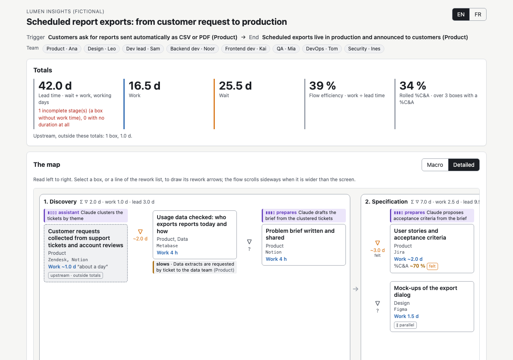
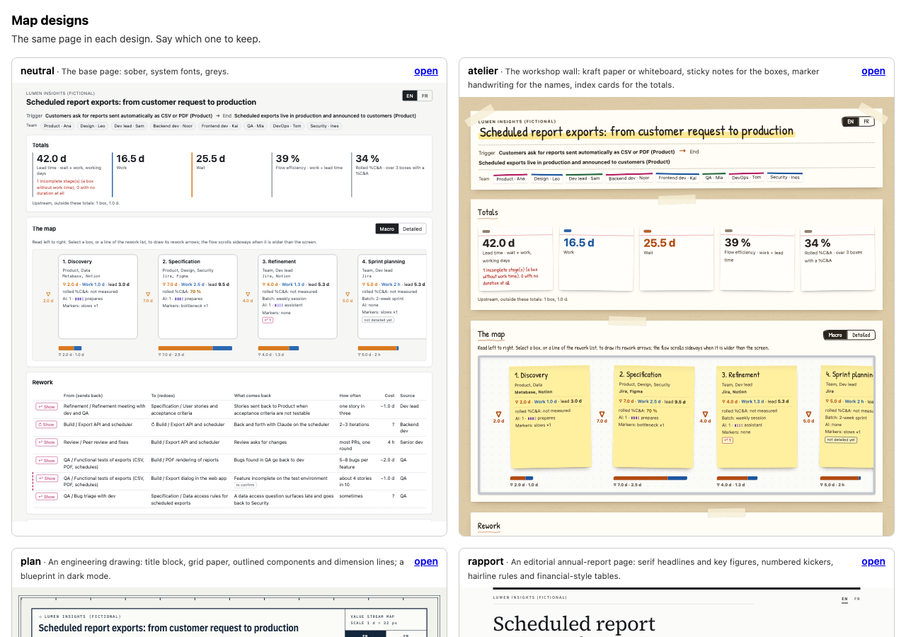

# Manufacture skills

Open skills for coding agents (Claude Code, Codex and any agent that reads skills: a folder with a `SKILL.md`). Each skill works on its own; together they compose.

Made by [Manufacture](https://manufacture.dev).

| Skill | What it does |
| --- | --- |
| [`mf-value-stream-map`](plugins/mf-value-stream-map) | Build a value stream map of a delivery flow with an agent: it interviews you (the stream first, the detail after), records what is said, computes the figures and shows the map on a local site or a single page, in any design and language. |
| [`mf-themes`](plugins/mf-themes) | Design systems for a page made by an agent: built-in themes (workshop wall, engineering drawing, editorial report), three radically different new directions made on the real page, a board to compare them, or your organisation's colours. |
| [`mf-i18n`](plugins/mf-i18n) | Languages for a page and its data: written in the language you speak, any number of others, whole-text translations kept with the data, translated labels, a switch or a list. |



## Install

Requires Node.js 18 or later (https://nodejs.org); nothing to install with npm. The agent checks it before the first command.

**Which way?** Pick one, by agent:

- **Claude Code:** the plugins, installed for you (the default scope), so the skills follow you in every project.
- **Codex:** the plugin.
- **Any other agent** (Cursor, GitHub Copilot and others): the skills CLI with `-g`, which installs for you rather than in the current project.
- **In a repository** (`.claude/skills/`, `.agents/skills/`, or `npx skills add` without `-g`): only for a team that wants to pin one version for everybody, committed with the code. You then update it yourselves.

Install each skill by **one way only** on a given agent: through two ways (the plugin and the skills CLI, say), the agent finds the skill twice and may load either copy, at different versions.

**Claude Code** (all of them, or only those you want):

```
/plugin marketplace add manufacture-dev/skills
/plugin install mf-value-stream-map@manufacture-skills
/plugin install mf-themes@manufacture-skills
/plugin install mf-i18n@manufacture-skills
```

**Codex:**

```
codex plugin marketplace add manufacture-dev/skills
codex plugin add mf-value-stream-map@manufacture-skills
```

**Any agent that reads skills** (Claude Code, Codex, Cursor, GitHub Copilot and others), with the [skills CLI](https://skills.sh):

```
npx skills add manufacture-dev/skills -g                         # choose the skills and the agents
npx skills add manufacture-dev/skills -g --skill mf-value-stream-map
```

**By hand:** copy `plugins/<plugin>/skills/<skill>` where your agent looks for skills (`.agents/skills/` or `~/.agents/skills/` for Codex, `.claude/skills/` for Claude Code), then restart the agent.

## Use

- *"Let's map our last feature that went to production, interview me."* The agent frames the case in the language you speak, builds the whole stream with you, then goes over what is missing theme by theme, and shows the map as it grows on a local site.
- *"Show me other designs for the map"*, *"use our colours"*, *"make us three new styles"* (mf-themes).
- *"Add English and German to the page"* (mf-i18n).

To try without your own data: [`examples/lumen-report-export.json`](examples/lumen-report-export.json), a fictional company's map (Lumen Insights), in English and French: *"Show me the map in examples/lumen-report-export.json"*.



## Where it works

The skills are made for agents that run commands on your computer: Claude Code (terminal, IDE, desktop app), Codex, Cursor and the like. The local site (`serve`) needs your own machine, since it shows the map in your browser while you talk. Where an agent cannot run commands, the skills' instructions still load, but the figures, the checks and the pages come from the scripts, so the result is not the same.

## What the skills run

Everything is plain, readable JavaScript, run with your own Node.js; no dependency, no package installed, nothing minified.

- **Scripts** (`scripts/*.mjs` in each skill), run by the agent when the skill tells it to. They read the files you name and write only the files you name (the map, a page, a folder of designs).
- **A local site** (`vsm.mjs serve`, mf-value-stream-map), only when asked: it listens on `127.0.0.1` only (your machine, not your network) and runs until the agent or you stop it.
- **No network.** The scripts make no request to any server, and nothing is sent anywhere: no telemetry, no account. Pages work offline: their fonts are embedded (free licences, next to each font).
- **One exception, on request:** to make a new theme, the agent downloads free fonts from [Fontsource](https://fontsource.org) (through cdn.jsdelivr.net) into the theme folder, as the mf-themes instructions say.
- **No hooks, no MCP servers, no background process:** nothing runs unless the agent uses a skill.

## How the library is built

- `plugins/<plugin>/skills/<skill>/`: each skill, self-contained (its `SKILL.md`, `scripts/`, `assets/`, `references/`), so it can be copied alone. Each plugin wraps one skill, for Claude Code and Codex.
- `lib/`: the code shared by several skills (`themes.mjs`, `i18n.mjs`). `node tools/sync.mjs` copies it into each skill's `scripts/lib/`, the built-in themes of mf-themes into the skills that ship them, and the library's version everywhere; edit the source, never a copy.
- `node tools/check.mjs` before committing (also run in CI): copies and versions in sync, themes valid, the example map valid and its page built in every design, a changelog line for any change since the last release.

## Versions

One version for the whole library ([CHANGELOG.md](CHANGELOG.md)), in semver, written in each skill (`metadata.version` in `SKILL.md`) and plugin. While it is 0.x, a minor version may change the map format or a command; the changelog says what to do. Maps carry their own format version (`schemaVersion`).

- **Claude Code:** `/plugin marketplace update manufacture-skills`, then update the plugins in `/plugin` (or turn on auto-update for the marketplace there).
- **Codex:** `codex plugin marketplace upgrade`.
- **skills CLI:** `npx skills update`.
- **Copied by hand:** copy the folder again; `metadata.version` in its `SKILL.md` says which version you have. A release is a tag `vX.Y.Z` with its notes on GitHub.

To release (maintainers): every change to `plugins/` or `lib/` adds a line under **Unreleased** in the changelog (`tools/check.mjs` refuses otherwise), then `node tools/release.mjs <x.y.z>` sets the version everywhere and prints the commit, tag and release commands.

## Licence

MIT, see [LICENSE](LICENSE). Fonts in the themes are under their own free licences (OFL-1.1), next to each font.
